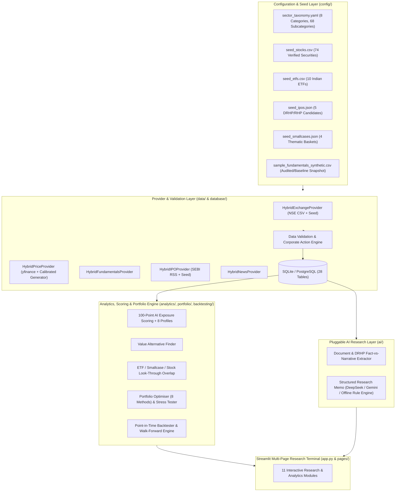

# AI Infrastructure Investment Intelligence (AI3) — System Architecture

## 1. Architectural Overview

AI3 is a modular, production-oriented quantitative equity, supply-chain, ETF/Smallcase overlap, circular-electronics, and IPO research platform designed for the Indian capital market (`NSE`, `BSE`, `NSE Emerge`, `BSE SME`) with global supply-chain benchmarks (`US`, `Taiwan`, `Japan`, `South Korea`, `Europe`).

## 2. Database Schema (28 Normalised Tables)

Defined in [`database/models.py`](file:///c:/Users/epurntr/Downloads/Gravity/AI-Data-Center-Growth-Theme/database/models.py) and [`database/migrations/init_schema.sql`](file:///c:/Users/epurntr/Downloads/Gravity/AI-Data-Center-Growth-Theme/database/migrations/init_schema.sql):

1. `securities` — Security master with effective dates, ISINs, exchange verification, and investability status.
2. `ticker_history` — Historical symbol aliases (`POWERINDIA` $\to$ `HITACHIEN`, `TARIL` $\to$ `TRIL`, `KPIL` $\to$ `KALPATARU`, `BBOX` $\to$ `BLACKBOX`).
3. `corporate_actions` — Splits, bonuses, dividends, mergers, rights issues, and suspensions.
4. `sector_taxonomy` — 8 primary categories (`A`–`H`) and 68 granular subcategories (`A1`–`H12`).
5. `company_sector_mappings` — Multi-tag company-to-sector and subcategory mappings.
6. `price_daily` — Point-in-time daily OHLCV, adjusted close, turnover, and provenance tags.
7. `index_prices` — Benchmark index series.
8. `financial_statements_annual` — Annual revenue, EBITDA, PAT, CFO, capex, FCF, debt, ROCE, ROE.
9. `financial_statements_quarterly` — Quarterly revenue, EBITDA, PAT, OPM, and order book.
10. `balance_sheets` — Detailed asset/liability and net-debt snapshots.
11. `cash_flows` — Operating, investing, financing, and free cash flow statements.
12. `valuation_metrics` — Trailing/forward P/E, EV/EBITDA, P/B, PEG, FCF yield, EV/Order Book.
13. `shareholding_patterns` — Promoter, FII, DII, public shareholding and promoter pledge %.
14. `company_relationships` — Customer, supplier, JV, and subsidiary links across the AI value chain.
15. `order_book_disclosures` — Confirmed backlog disclosures and execution horizons.
16. `etfs` — ETF metadata, expense ratios, AUM, tracking error, and AI/DC exposure %.
17. `etf_holdings` — Point-in-time ETF constituent weights.
18. `smallcases` — Smallcase/thematic basket metadata, lock status, and fee structure.
19. `smallcase_constituents` — Disclosed or user-uploaded smallcase holdings.
20. `ipos` — Mainboard and SME IPO candidates, DRHP/RHP dates, and confirmed-date flags.
21. `ipo_documents` — Parsed Objects of the Issue and filing links.
22. `new_listings` — Newly listed tracking metrics (<3 years on exchange).
23. `news_and_filings` — Corporate filings with fact-vs-narrative evidence classification.
24. `ai_exposure_scores` — Stored 100-point and profile-adjusted score breakdowns.
25. `risk_flags` — Explicit governance, balance-sheet, liquidity, and narrative risk flags.
26. `portfolios` — Saved custom/optimised portfolios.
27. `portfolio_holdings` — Portfolio constituent weights and roles.
28. `backtest_runs` — Historical point-in-time backtest audit records (plus `discovery_queue` and `job_runs`).
